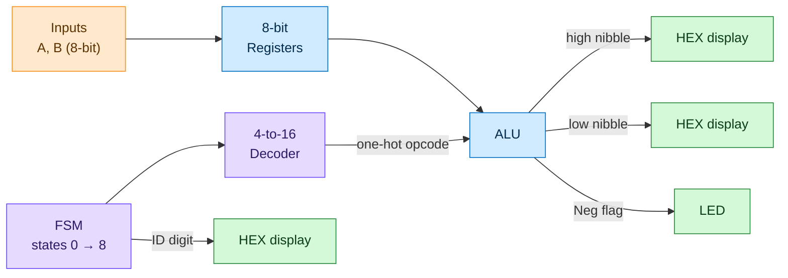

# FPGA ALU Processor Datapath

### An 8-bit, FSM-controlled ALU written in VHDL and running on real hardware

---

## Overview

This project is a small **processor datapath** built from scratch in VHDL. A finite state machine moves through nine states. In each state it picks a different ALU operation to run on two 8-bit inputs, and the result shows up live on the DE2 board's 7-segment displays.

It's the same basic structure every CPU uses: a **control unit** (the FSM and decoder) telling a **datapath** (the registers and ALU) what to do. It's just small enough here that you can watch every step happen on the board.

---

## How It Works

| Block | What it does |
|:--|:--|
| **Registers** | Two 8-bit registers capture A and B on each rising clock edge, with an active-low reset. |
| **FSM** | A 4-bit state counter that loops 0 → 8. On each step it also outputs one digit of a student ID. |
| **Decoder** | Turns the current state into a one-hot 16-bit "microcode" opcode. |
| **ALU** | Runs whichever operation the opcode selects, then splits the 8-bit result into two hex digits. |
| **7-segment drivers** | Active-low decoders that display the hex digits 0 through F. |

---

## What's Inside

### `alu-comparator-datapath`: Custom-Operation ALU

This version has an ALU with nine less common operations, mostly bit manipulation:

| State | Operation | | State | Operation |
|:--:|:--|:--:|:--:|:--|
| 0 | Swap nibbles of A | | 5 | max(A, B) |
| 1 | A OR B | | 6 | \|A − B\| + negative flag |
| 2 | B − 5 | | 7 | A XNOR B |
| 3 | NOT A | | 8 | Rotate B left by 3 |
| 4 | Reverse bit order of A | | | |

> **Self-checking testbench:** `tb_alu.vhd` runs all nine operations against known answers (A = `0xA3`, B = `0x95`) using `ASSERT` statements. It also has a separate check for a negative subtraction, so any mistake fails the simulation right away.

**Footprint:** 128 logic elements · 29 registers · less than 1% of the chip

 

### `fsm-alu-datapath`: Standard ALU + ID-Digit Matcher

This version swaps in a more traditional ALU and adds a matching feature on top.

**ALU operations:** `ADD` · `SUB` (with negative flag) · `NOT` · `NAND` · `NOR` · `AND` · `XOR` · `OR` · `XNOR`

**New modules:**
- **`compare_yn`** checks whether either digit of input B matches the ID digit the FSM is currently on.
- **`sseg_yn`** shows a **`y`** or **`n`** on a 7-segment display depending on the match.

> **Design reuse:** the FSM, decoder, registers and display drivers are the same files as in `alu-comparator-datapath`. Only the ALU and the compare logic changed, which is what keeping each module separate makes possible.

**Footprint:** 122 logic elements · 29 registers · 47 I/O pins

---

## Skills Demonstrated

- **RTL design in VHDL:** modular, structural top-level design using component instantiation
- **FSM design:** a Moore-style state counter with an output lookup table
- **Control logic:** one-hot decoding and microcode-style operation select
- **ALU design:** arithmetic, logic, bit operations and signed-magnitude subtraction with `numeric_std`
- **Verification:** testbenches that check their own results
- **Full FPGA flow:** synthesis → fitting → pin assignment → timing analysis → programming the board

---

## Tools

| | |
|:--|:--|
| **Language** | VHDL |
| **Toolchain** | Intel / Altera Quartus II 13.0 |
| **Simulation** | ModelSim |
| **Hardware** | Altera DE2 · Cyclone II `EP2C35F672C6` |

---

## Running It Yourself

1. Open the `.qpf` project file for either folder in **Quartus II**.
2. Compile the design (**Processing → Start Compilation**).
3. Program the DE2 board with the generated `.sof` file.
4. Set **A** and **B** on the switches, then press the clock key to step through the operations.

To simulate, compile the ALU and `tb_alu.vhd` in ModelSim and run the testbench. If every check passes, it prints `ALL PROBLEM 2(b) ALU CHECKS PASSED`.

---

